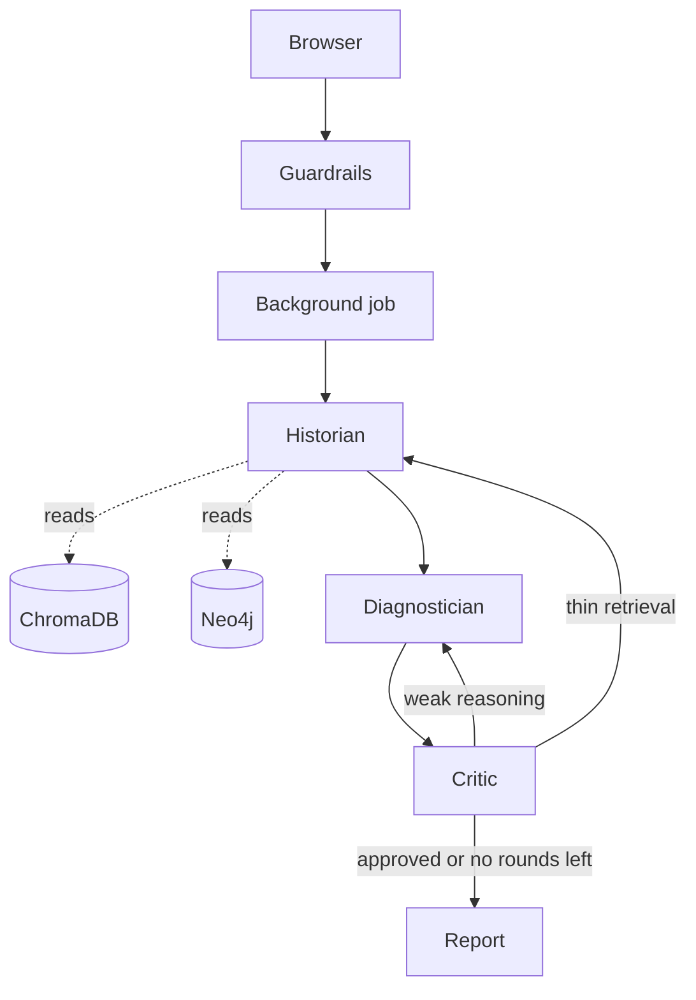

# Agentic AI System for Longitudinal Patient Case Summarization and Hypothesis Generation

**Course:** AI4015 Agentic Artificial Intelligence

A full-stack AI application where three specialized AI agents work together on clinical cases. Unlike a normal chatbot, it runs a stateful, self-correcting loop: it builds a patient timeline from retrieved evidence, proposes three differential diagnoses, and then checks its own reasoning before returning a report.

> **Research project only.** Outputs are not a diagnosis and must not be used for clinical decisions. Every report ends with a disclaimer.

## Key Features

- **Three-agent loop (LangGraph):** Historian, Diagnostician and Critic share one state. The Critic can send work back for another pass. The final round is always reviewed, and unresolved issues are kept in the report.
- **Hybrid retrieval (RAG + GraphRAG):** semantic search in ChromaDB plus structured case facts from a Neo4j knowledge graph.
- **Graph integrity:** confirmed diagnoses (`HAS_CONFIRMED_DIAGNOSIS`) are stored separately from ruled-out ones (`CONSIDERED_DIAGNOSIS`), so a rejected disease is never presented as a fact.
- **Live progress:** analyses run as background jobs. The browser polls every 2 seconds and shows each agent step as it finishes.
- **Deterministic guardrails:** plain code (no LLM) rejects empty or oversized objectives, prompt-injection attempts and personal dosing questions.
- **Translation pipeline:** MedChain is Chinese. Cases are translated to English with a model fallback chain, a disk cache and resumable progress.
- **Clinical tools:** lab value interpreter, drug interaction checker (small curated table) and medical web search, also exposed through an MCP server.
- **Dashboard:** dark Next.js app with 7 pages, including a Pipeline page that explains the whole flow.

## Architecture



**Phase 1: data preparation (offline, per case)**
MedChain JSON -> flatten and label specialty -> translate to English (cached) -> chunk (1000 characters, 150 overlap) -> embed (MiniLM, local) -> index in ChromaDB. Separately, `build_kg.py` extracts symptoms, diagnoses and treatments into Neo4j.

**Phase 2: one analysis (online)**
1. **Historian:** retrieves 8 chunks (16 on a retry), adds Neo4j entities, and writes a 7-section timeline (1 LLM call).
2. **Diagnostician:** proposes exactly 3 ranked diagnoses with confidence, evidence and citations (1 LLM call).
3. **Critic:** checks for unsupported claims, contradictions, missing data and overconfidence, then picks a revision target (1 LLM call).

A single analysis makes at least 3 LLM calls. Revisions add more. Token counts are not recorded; check your Gemini and Groq dashboards.

**Databases and storage**

| Store | What it holds | Location |
| :--- | :--- | :--- |
| ChromaDB | Text chunks and vectors (collection `patient_records`) | `data/knowledge_base/chroma` |
| Neo4j 5.24 (Docker) | Case, Symptom, Diagnosis, Treatment nodes and their relations | `data/neo4j` |
| Translation cache | One line per translated case | `data/processed/translation_cache.jsonl` |
| Progress file | Ingestion position and failed cases | `data/processed/ingest_progress.json` |
| Job store | Running and finished jobs (last 50) | API memory, cleared on restart |
| Browser | Last 15 analyses and the active job id | `localStorage` |

## Tech Stack

| Layer | Technologies |
| :--- | :--- |
| Backend / API | Python 3.13, FastAPI, Uvicorn, Pydantic |
| Orchestration | LangGraph, LangChain |
| LLMs (free tier) | Gemini `gemini-flash-latest` (primary), Groq `openai/gpt-oss-120b` (fallback). Translation uses Groq `gpt-oss-120b`, then `gpt-oss-20b`, then Gemini |
| Embeddings | `sentence-transformers/all-MiniLM-L6-v2` (local CPU, no token needed) |
| Databases | ChromaDB (vector), Neo4j (graph) |
| Frontend | Next.js 16 (App Router), React, TypeScript, Tailwind CSS v4, shadcn/ui, Framer Motion, TanStack Query, React Hook Form, Zod, Lucide |
| Protocol | FastMCP (Model Context Protocol server) |
| Testing / eval | pytest, RAGAS |
| Dataset | MedChain (Hugging Face `ljwztc/MedChain`, 12,163 cases) |

## Project Structure

```text
AI4015-Agentic-AI-Project/
├── data/                  # Raw dataset, ChromaDB, Neo4j volumes, translation cache
├── docs/                  # Architecture diagrams (Mermaid and PNG)
├── external/              # Cloned MedChain reference code
├── frontend/              # Next.js web application (TypeScript, Tailwind)
├── logs/                  # Runtime log files
├── notebooks/             # Jupyter notebooks for exploration
├── scripts/               # CLI tools for ingestion, KG building, testing
├── src/                   # Python backend source code
│   ├── agents/            # Historian, Diagnostician, Critic nodes
│   ├── api/               # FastAPI app, routes, schemas, job runner
│   ├── evaluation/        # RAGAS offline evaluation scripts
│   ├── graph/             # LangGraph workflow definition
│   ├── ingestion/         # Loaders, translators, chunkers, KG builder
│   ├── mcp_server/        # Model Context Protocol server
│   ├── models/            # LLM client factory
│   ├── prompts/           # System prompts for each agent
│   ├── retrieval/         # ChromaDB and Neo4j wrappers
│   ├── tools/             # Lab calculator, drug interaction, web search
│   └── utils/             # Config, logger, guardrails
├── tests/                 # Pytest unit tests
├── .env                   # API keys and connection strings (never commit)
├── config.yaml            # Non-secret configuration (models, limits)
├── docker-compose.yml     # Spins up the local Neo4j container
├── pytest.ini             # Test configuration and markers
└── requirements.txt       # Python dependencies
```

## Prerequisites

| Tool | Notes |
| :--- | :--- |
| Git | To clone the repo |
| Python 3.13 | Version the project was built and tested with |
| Node.js 20 or newer | Built with Node 24. Includes npm |
| Docker Desktop | Runs Neo4j. Must be open before `docker compose` |
| Gemini API key | Free, from Google AI Studio |
| Groq API key | Free, from console.groq.com |

No Hugging Face token is needed. Commands below are for **Windows PowerShell**. On macOS or Linux, use `/` instead of `\` in paths. No virtual environment is used, so packages install into your main Python.

## Setup

### 1. Clone the repository

```powershell
# Downloads the repo into a folder named AI4015-Agentic-AI-Project
git clone https://github.com/zahmed02/AI4015-Agentic-AI-System-for-Longitudinal-Patient-Case-Summarization-and-Hypothesis-Generation.git AI4015-Agentic-AI-Project
cd AI4015-Agentic-AI-Project
```

`data/` is git-ignored, so a fresh clone has no dataset or databases. Follow "Prepare the data" below.

### 2. Create the `.env` file (project root)

Create `.env` in a text editor. Do not create it with `Set-Content` in Windows PowerShell 5.1, which can add an invisible BOM.

```env
GEMINI_API_KEY=your_gemini_key
GROQ_API_KEY=your_groq_key
NEO4J_URI=bolt://localhost:7687
NEO4J_USERNAME=neo4j
NEO4J_PASSWORD=change_this_password
CHROMA_PERSIST_DIR=./data/knowledge_base/chroma
PRIMARY_LLM=gemini-flash-latest
FALLBACK_LLM=openai/gpt-oss-120b
EMBEDDING_MODEL=sentence-transformers/all-MiniLM-L6-v2
```

`PRIMARY_LLM` and `FALLBACK_LLM` override the models in `config.yaml`. `NEO4J_PASSWORD` must match `NEO4J_AUTH` in `docker-compose.yml`. Neo4j sets its password only the first time `data/neo4j` is created.

### 3. Install backend dependencies (run in the project root)

```powershell
# Updates pip itself
python -m pip install --upgrade pip
# Installs every Python package listed in requirements.txt
pip install -r requirements.txt
```

The first run also downloads the embedding model (about 90 MB) automatically.

| Group | Packages |
| :--- | :--- |
| Orchestration | `langgraph`, `langchain`, `langchain-core`, `langchain-community` |
| LLM providers | `langchain-google-genai`, `google-genai`, `langchain-groq`, `groq` |
| Vector store and embeddings | `chromadb`, `sentence-transformers`, `langchain-chroma`, `langchain-huggingface` |
| Graph | `neo4j` |
| MCP | `fastmcp` |
| API | `fastapi`, `uvicorn[standard]`, `pydantic`, `python-dotenv` |
| Data | `pandas`, `numpy`, `datasets`, `huggingface_hub`, `pypdf` |
| Evaluation | `ragas` |
| Translation | `langdetect`, `deep-translator` |
| Dev and misc | `jupyter`, `pytest`, `tqdm`, `grandalf` (graph drawing), `pyyaml` (reads `config.yaml`) |

### 4. Start Neo4j (project root)

```powershell
# Pulls the neo4j:5.24 image on first run and starts the medchain-neo4j container in the background
docker compose up -d
# Prints "Neo4j connection successful!" once the database is ready (can take up to a minute)
python scripts\test_neo4j.py
```

### 5. Install frontend dependencies (run inside `frontend`)

```powershell
cd frontend
# Installs everything listed in package.json
npm install
cd ..
```

Optional: create `frontend\.env.local` with `NEXT_PUBLIC_API_URL=http://127.0.0.1:8000`. This is already the default and only matters if you change the API port.

<details>
<summary>Commands originally used to create the frontend (history, not needed after cloning)</summary>

```powershell
# Project root: creates the frontend folder (Next.js, TypeScript, Tailwind, ESLint, App Router, src/ folder, @/ import alias)
npx create-next-app@latest frontend --typescript --tailwind --eslint --app --src-dir --import-alias "@/*" --use-npm --no-turbopack

# All following commands run inside the frontend folder
cd frontend

# Data fetching and caching
npm install @tanstack/react-query @tanstack/react-query-devtools

# Icons and styling helpers
npm install lucide-react clsx tailwind-merge class-variance-authority

# Forms and validation
npm install zod react-hook-form @hookform/resolvers

# UI components: initialize shadcn/ui, then add primitives
npx shadcn@latest init -d
npx shadcn@latest add button card badge tabs table separator scroll-area skeleton alert progress select dialog

# Animations
npm install framer-motion
```
</details>

## Prepare the data (run in the project root)

```powershell
# 1. Downloads MedChain from Hugging Face into data\raw\MedChain (public, no token).
#    Only merged_cases.json is used; the image files in the download are not.
python scripts\download_dataset.py

# 2. Translates, chunks, embeds and indexes 100 new cases into ChromaDB, saving to the database every 10.
#    It is resumable: run it again to continue from where it stopped.
python scripts\ingest_stream.py --limit 100 --flush-every 10

# 3. Checks what was indexed and that search works
python scripts\list_indexed_cases.py
python scripts\verify_search.py --query "chest pain with fever"

# 4. Builds the knowledge graph (one LLM call per case; skips cases already in the graph)
python scripts\build_kg.py --case-id 48,28,30     # specific cases
python scripts\build_kg.py                        # every case currently in ChromaDB
```

Translation is rate limited to 15 requests per minute, so ingestion is slow by design. The project indexes a subset of the 12,163 cases because of free-tier limits.

## Run the project

Open **3 PowerShell windows** (Docker Desktop must be running):

| Window | Folder | Command | What it does |
| :--- | :--- | :--- | :--- |
| 1 | project root | `docker compose up -d` | Starts Neo4j |
| 2 | project root | `uvicorn src.api.main:app --reload --port 8000` | Starts the FastAPI backend, auto-restarts on code changes |
| 3 | `frontend` | `npm run dev` | Starts the Next.js dashboard |

Then open **http://localhost:3000**.

| Port | Service |
| :--- | :--- |
| 3000 | Frontend |
| 8000 | API (interactive docs at `/docs`) |
| 7474 | Neo4j Browser (login `neo4j` and your `NEO4J_PASSWORD`) |
| 7687 | Neo4j Bolt connection |

```powershell
# Stop: press Ctrl+C in windows 2 and 3, then:
docker compose stop     # stops Neo4j, keeps data
docker compose down     # removes the container, data in data\neo4j stays
```

Run one analysis from the terminal without the UI:

```powershell
python scripts\run_agent.py --case-id 48 --max-iterations 3
python scripts\run_agent.py --query "hepatitis B with jaundice"
```

## Frontend Pages

| Route | Purpose |
| :--- | :--- |
| `/` | Overview: corpus numbers, specialty chart, recent analyses |
| `/analyze` | Run an analysis, watch the agents live, read results, reopen history |
| `/cases` | Search and filter indexed cases. A popup shows one case's text and graph entities |
| `/knowledge-graph` | Neo4j stats, graph drawing for any case, entity search |
| `/tools` | Lab interpreter, drug interactions, reference search |
| `/pipeline` | Animated explanation of the full project flow |
| `/system` | Service health, models, guardrails, MCP tools |

## API Endpoints

| Method | Path | Purpose |
| :--- | :--- | :--- |
| GET | `/health` | Chroma chunk count |
| GET | `/system/status` | Services, models, guardrails, MCP tools |
| GET | `/cases`, `/cases/{case_id}` | Case list, one case with chunks and graph entities |
| POST | `/analyze/start` | Start a background analysis, returns a job id |
| GET | `/analyze/jobs/{job_id}` | Job events and result |
| POST | `/analyze` | Blocking version (waits for the full result) |
| GET | `/graph/stats`, `/graph/case/{case_id}`, `/graph/search?keyword=` | Knowledge graph data |
| POST | `/tools/labs`, `/tools/drugs`, `/tools/search` | Clinical tools |

## Scripts (run from the project root)

| Script | Purpose |
| :--- | :--- |
| `ingest_stream.py --limit N --flush-every M` | Translate and index N new cases, flushing every M |
| `ingest_batch.py --size N --max-total T` / `--status` | Index N cases per run up to T total, or show progress |
| `ingest_full.py --limit N` / `--reset` | Run until done or the API limit, or restart progress |
| `flush_cached.py [--dry]` | Rebuild ChromaDB from the translation cache (no API calls) |
| `build_kg.py [--case-id 48,77]` | Fill the Neo4j knowledge graph |
| `list_indexed_cases.py`, `verify_search.py` | Inspect the vector store |
| `run_agent.py --case-id ID` or `--query TEXT` | Full analysis with a printed report |
| `test_historian.py`, `test_diagnostician.py`, `test_critic.py`, `test_critic_loop.py`, `test_workflow.py` | Manual agent tests (use LLM quota) |
| `test_neo4j.py` | Checks the Neo4j connection |
| `render_graph.py` | Saves the workflow as `docs\graph.mmd` and `docs\graph.png` (PNG needs internet) |

## Configuration

`config.yaml` holds non-secret settings: primary and fallback models, chunk size (1000) and overlap (150), collection name, guardrail limits (`max_objective_length: 500`, `require_disclaimer`) and data paths. Secrets stay in `.env`.

## Testing and Evaluation

```powershell
# 20 fast tests (parsing, routing, ingestion helpers, guardrails). No LLM quota used.
pytest -m "not slow" -q

# One full-pipeline test that calls the real LLMs
pytest -m slow

# Frontend type-check and lint (run inside frontend)
cd frontend
npx tsc --noEmit
npm run lint
cd ..

# Offline RAGAS evaluation (faithfulness and answer relevancy, Gemini as judge, uses LLM quota)
python -m src.evaluation.ragas_eval
```

## MCP Server

```powershell
# Exposes 6 tools (labs, drugs, web search, case search, graph lookups) to MCP-compatible clients over stdio
python -m src.mcp_server.server
```

## Troubleshooting

- **Neo4j "incomplete handshake":** the database is still starting. Wait up to a minute and retry.
- **`WinError 10013` on port 8000:** run `netstat -ano | findstr :8000` to find what uses it, or start uvicorn with `--port 8001` and set `NEXT_PUBLIC_API_URL` in `frontend\.env.local`.
- **Red status dot in the header:** the API or the Neo4j container is not running.
- **Gemini `429 RESOURCE_EXHAUSTED`:** free-tier quota. Calls fall back to Groq automatically.
- **Analysis disappears after editing a `.py` file:** `--reload` restarted the server and cleared the in-memory job. Avoid editing during a run.
- **"Unauthenticated requests to the HF Hub" warning:** harmless.

## Limitations

- Free API tiers limit ingestion speed and analysis volume. A full analysis takes about 3 to 5 minutes.
- Only cases you build appear in the knowledge graph. Analysis still works without it.
- The drug checker covers 7 well-known interactions. A pair that is not listed is not proof of safety.
- Case titles in lists are the original Chinese titles. The case text itself is English.
- Jobs live in API memory, and history lives in the browser, so neither is shared across machines.
- The API has no authentication and allows all origins. Restrict this before any real deployment.
- Experimental research system, not for clinical use.
